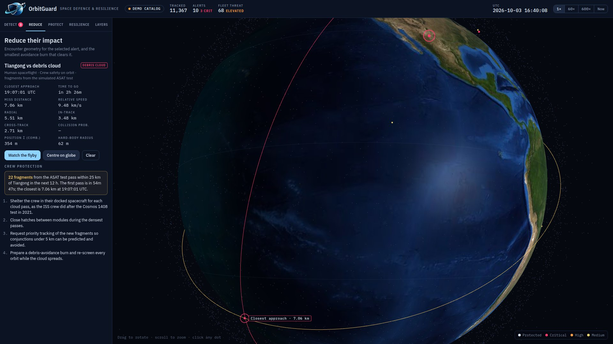

<p align="center"></p>

<h1 align="center">OrbitGuard Defence</h1>

<p align="center">Space domain awareness for when it matters: detect threats to critical satellites earlier, reduce their impact, protect the services that depend on them, and stay resilient.<br>
Built for <b>HackYeah 2026 · Open Task: Defence</b>.</p>

<p align="center"></p>

## What it does

OrbitGuard Defence tracks 10,000+ objects on a 3D globe and turns orbital data into answers to three questions: what is at risk, when, and what to do about it. The console has one tab for each part of the brief.

| Tab | What it does |
|---|---|
| **Detect** | Screens every protected satellite (ISS, Tiangong, GPS, Galileo, ICEYE, Sentinel-2B, Landsat 9, Terra, Hubble, NOAA-20, GOES-18) against the whole catalogue for the next 6, 12 or 24 h. Flags close approaches under 5 km and objects inside a 50 km keep-out zone around geostationary satellites. Ranks alerts by collision probability and writes an operations threat brief. |
| **Reduce** | Shows the encounter geometry (miss distance, radial / in-track / cross-track, relative speed, Pc) and plans the smallest avoidance burn: when, how big, how much propellant, and the new Pc. "Watch the flyby" jumps time to just before closest approach. |
| **Protect** | Links each fleet to the public service that depends on it (crew safety, positioning and bank or grid timing, flood mapping, weather) with a live risk level. Predicts the next ICEYE radar passes over a city for crisis response. |
| **Resilience** | What-if stress tests: an anti-satellite test that creates a debris cloud (Cosmos 1408-like), an inspector satellite drifting toward GOES-18, and loss of GPS or Galileo satellites over a city, with visible satellites and PDOP. Shows alerts and threat scores before and after, plus detection time. |
| **Layers** | Highlights constellations (Starlink, OneWeb, Kuiper, Iridium, ICEYE, Planet, GPS, Galileo, GLONASS, BeiDou, the GEO belt), historic debris clouds and famous objects. Search by name or NORAD ID. |

## Run it

No build step and no install.

- **Hosted:** open `index.html` from any static host (GitHub Pages, Netlify, Lovable `public/`). It loads live elements from CelesTrak and Earth textures from jsDelivr.
- **Offline / local:** open `offline/orbitguard-defence-offline.html` straight from disk. Everything is embedded.
- **Tracker only:** `tracker/index.html` is the 10,000-object tracker with constellation highlighting.

If CelesTrak can't be reached, the app switches to a simulated 10,000-object catalogue on the real orbital shells of each constellation and debris cloud, labelled **Demo catalog** in the top bar. You can also load your own 3-line TLE file from the Layers tab.

**GitHub Pages:** Settings → Pages → Deploy from a branch → `main` / root. The console is then served from `index.html`.

**Lovable:** see [docs/LOVABLE.md](docs/LOVABLE.md).

## How it works

- **Data:** CelesTrak GP data in TLE format (`active` plus constellation and debris groups), fetched in parallel through a fallback chain of proxies and cached for 2 hours, as CelesTrak asks.
- **Propagation:** SGP4 via [satellite.js](https://github.com/shashwatak/satellite-js) for real elements. The demo catalogue and scenario objects use Kepler orbits with J2 secular drift.
- **Screening:** 60 s steps over the look-ahead window. At each step, candidates within the protected satellites' altitude shells are binned into a 500 km spatial hash. Each protected satellite checks the 27 neighbouring cells, estimates the closest approach with linear relative motion, then refines it with golden-section search on full propagation.
- **Collision probability:** 2D Gaussian with an isotropic combined position uncertainty (250 m per object for simulated objects; 0.5 km + 0.3 km per day of element age for TLEs) and a hard-body radius per fleet (about 60 m for crewed stations).
- **Threat score (0–100):** log-scaled worst Pc, plus the number of elevated events with diminishing returns, plus terms for proximity and debris-cloud passes. Fleet threat weights each fleet by how critical its service is.
- **Avoidance burn:** Clohessy–Wiltshire relative motion for a tangential burn ½, 1, 2 or 3 orbits before closest approach, projected onto the encounter plane. Solves for the smallest Δv that opens the miss distance to 1, 2 or 5 km.
- **ASAT scenario:** about 1,500 fragments with isotropic Δv kicks (log-normal, median ≈ 70 m/s). Crewed stations also count fragment passes within 25 km, which is what led the ISS crew to shelter after Cosmos 1408.
- **GNSS resilience:** satellites above 10° elevation from the chosen city, with PDOP from the geometry matrix.
- **Radar passes:** ICEYE satellites at least 40° above the horizon over the chosen city in the next 24 h.
- **Threat brief:** written by Claude when the page runs as a Claude artifact. Elsewhere a rule-based summary is written from the same data.
- **Rendering:** three.js r128, GPU point cloud for all objects, day/night Earth shader with city lights.

## Limitations

- Collision probability uses an assumed, isotropic covariance. It is not a substitute for operator-grade conjunction data messages (CDMs).
- The demo catalogue is simulated. Positions are illustrative, though the shells, inclinations and debris clouds follow real ones.
- TLE/SGP4 accuracy is around a kilometre and degrades with element age.

## Roadmap

Ingest Space-Track CDMs and real covariances, add email/SMS alerting and operator accounts, validate against CelesTrak SOCRATES, and integrate with POLSA and EU SST.

## Repository layout

```
index.html                                hosted console (GitHub Pages / Lovable)
offline/orbitguard-defence-offline.html   self-contained console
tracker/index.html                        10,000-object tracker
assets/                                   logo and cover image
source/                                   page templates, textures and build.py
docs/                                     HackYeah submission text, Lovable steps
```

Rebuild all pages after editing a template: `python3 source/build.py`

## Credits

Orbital data: [CelesTrak](https://celestrak.org). SGP4: satellite.js (MIT). 3D: three.js (MIT). Earth textures: NASA Blue Marble and Black Marble, via the three-globe examples. Debris figures: ESA Space Environment Report 2025.
